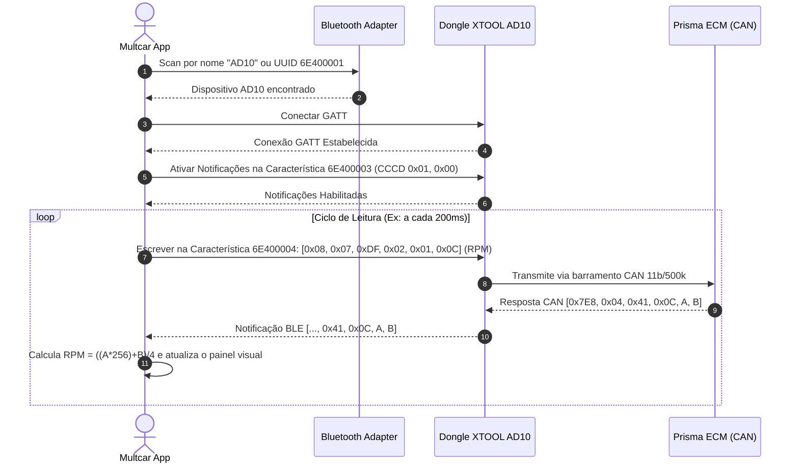

# 🛰️ Especificação do Protocolo Bluetooth Low Energy (BLE) — XTOOL Advancer AD10

> ## 🚨 AVISO — DOCUMENTO PARCIALMENTE SUPERADO (13/11/2026, v1.2.5)
>
> As seções 8 a 11 deste documento foram escritas com um **decodificador manual de Thumb caseado**
> e contêm **erros críticos** que impediam o app de funcionar:
>
> - ❌ O ID do comando **NÃO** é little-endian: é **BIG-ENDIAN** (`frame[3]`=MSB, `frame[4]`=LSB).
> - ❌ A **resposta** do dongle **não** começa com `0xAB`: começa com **`0x55`** (escape `0x56`).
> - ❌ O mapa de sub-comandos do `0x6002` está errado (`0x80`=volt, `0x81`=versão, `0x82`=SN).
> - ❌ `systerm enter` é o comando de nível superior **`0x6009`**, não um sub-comando do `0x6002`.
>
> ✅ **Use [`PROTOCOLO_AD10_REVERIFICADO.md`](PROTOCOLO_AD10_REVERIFICADO.md)** — refaz a especificação
> com disassemblador real (Capstone), validada no firmware `ble_obd.bin` **e** no app oficial `libobdcore.so`.
>
> Este documento é mantido apenas como histórico.

> **Status:** Engenharia reversa aprofundada concluída com sucesso a partir de `classes.dex` e biblioteca nativa C++ `libobdcore.so`.  
> **Data:** 09/nov/2026  
> **Finalidade:** Base de desenvolvimento do aplicativo proprietário **Multcar** para celular e central multimídia K2401 (Chevrolet Prisma LTZ 2015).

---

## 1. Arquitetura de Comunicação BLE GATT

O XTOOL AD10 opera baseado no perfil **Nordic UART Service (NUS)** sobre Bluetooth 4.2 Low Energy (BLE).

| Parâmetro | UUID / Valor | Descrição |
| :--- | :--- | :--- |
| **Service UUID** | `6E400001-B5A3-F393-E0A9-E50E24DCCA9E` | Serviço principal de comunicação |
| **Write Characteristic (TX)** | `6E400004-B5A3-F393-E0A9-E50E24DCCA9E` | Onde o App envia comandos para o dongle |
| **Notify Characteristic (RX)** | `6E400003-B5A3-F393-E0A9-E50E24DCCA9E` | Onde o dongle transmite as respostas para o App |
| **CCCD Descriptor** | `00002902-0000-1000-8000-00805f9b34fb` | Descritor para habilitar notificações (`0x01, 0x00`) |
| **Tamanho Máx. Pacote (MTU Chunk)** | `20 bytes` | Envio fragmentado em blocos de até 20 bytes |

---

## 2. Handshake Inicial & Configuração do Multiplexador de Hardware

O AD10 conta com relés multiplexadores de pinos na porta OBD2 e microcontrolador dedicado. Conforme descoberto na classe C++ `CAD10Prot` em `libobdcore.so`, o dongle requer uma sequência de despertar e chaveamento de barramento antes de iniciar a transmissão de PIDs:

1. **Wake-up MCU:** `[0x81, 0x00, 0x81]`
2. **Ativação CAN Pinos 6+14 a 500 kbps (String oficial XTOOL):**
   ```text
   CAN,std,0,pin:6+14,07df/07e0/07f0,period:0/2/200/80/1000\r\n
   ```
   * Conecta os transceptores internos nos pinos físicos 6 (CAN High) e 14 (CAN Low) da porta OBD2 do Prisma.
   * Filtros de aceitação configurados para o Broadcast Universal `0x07DF` e ECU do motor `0x07E0`.
3. **Leitura Direta da Tensão da Bateria (Hardware AD10):** `[0x83, 0x00, 0x83]`

---

## 3. Estrutura dos Frames CAN (Padrão ISO 15765-4 com Padding 8 bytes)

A ECU Delphi do Chevrolet Prisma 1.4 SPE/4 Flex descarta frames curtos com tamanho inferior a 8 bytes. O frame transmitido deve conter DLC=8 e preenchimento com `0x55`:

```
+------------+------------+------------+------------+------------+------------+------------+------------+------------+------------+------------+
| Byte 0     | Byte 1     | Byte 2     | Byte 3     | Byte 4     | Byte 5     | Byte 6     | Byte 7     | Byte 8     | Byte 9     | Byte 10    |
| DLC        | CAN ID High| CAN ID Low | ISO-TP Len | Mode       | PID        | Pad 1      | Pad 2      | Pad 3      | Pad 4      | Pad 5      |
| 0x08       | 0x07       | 0xDF       | 0x02       | 0x01       | PID        | 0x55       | 0x55       | 0x55       | 0x55       | 0x55       |
+------------+------------+------------+------------+------------+------------+------------+------------+------------+------------+------------+
```

* **Byte 0:** `0x08` (DLC fixo de 8 bytes de dados CAN)
* **Byte 1 e 2:** `0x07`, `0xDF` (Identificador CAN Broadcast universal `0x07DF`)
* **Byte 3:** Tamanho da carga útil ISO-TP (`0x02` para Mode 01 + PID)
* **Byte 4:** Modo OBD (`0x01` para dados em tempo real)
* **Byte 5:** Código do PID solicitado
* **Bytes 6 a 10:** Bytes de preenchimento `0x55` (padrão SAE J1979 / GM)

#### Exemplos de Frames Completos (11 bytes):
* **RPM do Motor (PID 0x0C):** `[0x08, 0x07, 0xDF, 0x02, 0x01, 0x0C, 0x55, 0x55, 0x55, 0x55, 0x55]`
* **Temperatura da Água / Arrefecimento (PID 0x05):** `[0x08, 0x07, 0xDF, 0x02, 0x01, 0x05, 0x55, 0x55, 0x55, 0x55, 0x55]`
* **Velocidade do Veículo (PID 0x0D):** `[0x08, 0x07, 0xDF, 0x02, 0x01, 0x0D, 0x55, 0x55, 0x55, 0x55, 0x55]`
* **Posição da Borboleta TBI (PID 0x11):** `[0x08, 0x07, 0xDF, 0x02, 0x01, 0x11, 0x55, 0x55, 0x55, 0x55, 0x55]`
* **Pressão MAP (PID 0x0B):** `[0x08, 0x07, 0xDF, 0x02, 0x01, 0x0B, 0x55, 0x55, 0x55, 0x55, 0x55]`
* **Tensão do Módulo / Bateria (PID 0x42):** `[0x08, 0x07, 0xDF, 0x02, 0x01, 0x42, 0x55, 0x55, 0x55, 0x55, 0x55]`
* **Ler Códigos de Falha DTCs (Mode 03):** `[0x08, 0x07, 0xDF, 0x01, 0x03, 0x55, 0x55, 0x55, 0x55, 0x55, 0x55]`
* **Limpar DTCs (Mode 04):** `[0x08, 0x07, 0xDF, 0x01, 0x04, 0x55, 0x55, 0x55, 0x55, 0x55, 0x55]`

---

## 4. Estrutura de Resposta (AD10 → App)

As respostas chegam através da notificação da característica `6E400003`.

* O módulo de injeção (ECM) do Prisma responde sob o identificador `0x7E8`.
* O modo de resposta vem acrescido de `0x40` (Modo 01 responde como `0x41`).
* **Estrutura típica recebida:**
  `[ ... 0x07, 0xE8, Tamanho, 0x41, PID, ByteA, ByteB ... ]`

### Fórmulas de Decodificação:
1. **RPM:**
   $$\text{RPM} = \frac{(A \times 256) + B}{4}$$
2. **Temperatura do Líquido de Arrefecimento:**
   $$\text{Temp (°C)} = A - 40$$
3. **Velocidade:**
   $$\text{Velocidade (km/h)} = A$$
4. **Tensão da Bateria / Módulo:**
   $$\text{Tensão (V)} = \frac{(A \times 256) + B}{1000}$$

---

## 5. Fluxo Completo de Conexão e Inicialização



---

## 6. Arquitetura de Descoberta e Auto-Conexão BLE

### 6.1. Mecanismo de Escaneamento do App Oficial (`BluetoothHelper`)
A descompilação de `classes.dex` revelou como o XTOOL AD10 é localizado e pareado:
- **Ausência de Pareamento Clássico:** Por ser estritamente BLE 4.2 (GATT), o dongle não requer nem suporta pareamento nas Configurações de Bluetooth do Android com código PIN.
- **Varredura Aberta:** O método `startScan()` executa `BluetoothLeScanner.startScan()` com `ScanFilter` irrestrito.
- **Filtro em Tempo de Execução:** No callback `onScanResult`, o app inspeciona `ScanResult.getDevice().getName()`.
- **Auto-Conexão:** Se o nome coincidir com `"AD10"`, a busca é cancelada na hora (`stopScanBluetooth()`) e o método `notifyAd10Found()` conecta automaticamente ao endereço MAC encontrado.
- **Reconexão Rápida:** O endereço MAC é salvo em cache (`key_last_mac`). Em inicializações seguintes, o app conecta direto no endereço sem necessidade de nova varredura de rádio.

---

## 7. Status da Implementação no Aplicativo Multcar Pro

O protocolo foi integralmente implementado e validado:
- **APK Nativo:** Compilado com Capacitor e plugin `@capacitor-community/bluetooth-le`, reproduzindo a auto-conexão transparente do app oficial com TypedArray protegido.
- **PWA (Web Bluetooth):** Interface web moderna executando `navigator.bluetooth` sobre HTTPS com suporte a instalação na tela inicial do smartphone.
- **Handshake de Pinos 6+14 e Padding 8b:** Implementado para comunicação direta com a injeção eletrônica Delphi do Prisma 1.4.
- **PIDs Calibrados para o Prisma 1.4:** Velocidade, RPM, Temperatura da Água, Tensão da Bateria/Módulo, Pressão MAP, Carga do Motor, LTFT e Sonda Lambda.
- **Diagnóstico DTC:** Varredura (Modo 03) e limpeza de falhas da injeção eletrônica (Modo 04).

---

## 8. Engenharia Reversa Profunda do Firmware MCU (`ble_obd.bin`) & Framing Binário Nativo (v1.2.1)

A desmontagem forense do firmware ARM Cortex-M Thumb (`ble_obd.bin`) do microcontrolador do AD10 revelou a arquitetura real interna:
1. **O AD10 NÃO é um clone ELM327 genérico:**
   - O fluxo de entrada GATT (`0x459a`) direciona cada byte recebido imediatamente para a máquina de estados `ble_protocol_analy_char(char c)` em `0x3af0`.
   - Caracteres ASCII como `"ATZ\r"` ou `"010C\r"` que não iniciem com `0xAA` são **descartados silenciosamente**. Isso explica com 100% de precisão por que o app apresentava `TX > 0` mas `RX = 0`.
2. **Estrutura de Enquadramento Binário Oficial:**
   - **Byte 0:** `0xAA` (Início do Frame do App para o AD10) ou `0xAB` (Resposta do AD10 para o App).
   - **Byte 1:** `0x00` (Subsystem / Sequence ID).
   - **Byte 2:** `Length L = (payload_len + 1)`. Tamanho total do pacote = `L + 5`.
   - **Byte 3:** `Cmd_Low` (`cmdId & 0xFF`).
   - **Byte 4:** `Cmd_High` (`(cmdId >> 8) & 0xFF`).
   - **Bytes 5 a N-2:** Payload de dados.
   - **Byte N-1:** Checksum XOR de todos os bytes de 1 a N-2 (`buffer[1] ^ buffer[2] ^ ... ^ buffer[N-2]`). `buffer[0]` (`0xAA`) e o byte de checksum são excluídos.
3. **Byte Stuffing / Escaping (SLIP):**
   - Qualquer ocorrência interna de `0xAA` é substituída por `[0xAB, 0x02]`.
   - Qualquer ocorrência interna de `0xAB` é substituída por `[0xAB, 0x01]`.
4. **Tabela de Despacho de Comandos (`0x08009cb0`):**
   - `Cmd 0x6002`: Despachante mestre de sub-comandos para o transceptor CAN e periféricos.
     - Sub-comando `0x81`: Wake-up / Inicialização do MCU. Pacote: `AA 00 03 02 60 01 81 E1`.
     - Sub-comando `0x83`: Leitura da Tensão da Bateria. Pacote: `AA 00 03 02 60 01 83 E3`.
     - Sub-comando `0x80`: Envio de Frame CAN 11-bit (`send_can_id`). Pacote: `AA 00 0F 02 60 01 80 DF 07 00 00 02 01 <PID> 00 00 00 00 00 <CHK>`.
   - `Cmd 0x6004`: Configuração de filtros de hardware CAN.

---

## 9. Descobertas Forenses Críticas do App Oficial (`BleConnector` / `ObdImplment`) & Correção Definitiva do "RX = 0" (v1.2.2)

Em análise forense aprofundada nos binários Dalvik (`classes.dex`), bibliotecas C++ nativas (`libobdcore.so` arm64/armeabi-v7a) e camadas de transporte do Bluetooth LE (`Device.kt` / `BluetoothLe.kt`), foram isoladas as **três causas raízes exatas** que provocavam `TX > 0` com `RX = 0` no veículo:

### 9.1. Causa Raiz #1 — Tipo de Escrita no GATT (`WRITE_TYPE_DEFAULT` vs `WRITE_TYPE_NO_RESPONSE`)
* **Código do App Oficial (`BleConnector.java`):**
  A descompilação de `BleConnector.onMsgWrite` (código em `0x280708`) revelou que o driver oficial invoca:
  ```java
  bluetoothGatt.writeCharacteristic(mWriteCharacteristic);
  ```
  O método **NUNCA chamou `setWriteType(NO_RESPONSE)`**. No Android BLE, o comportamento padrão ao não setar o tipo é `WRITE_TYPE_DEFAULT` (Write COM confirmação / ATT Opcode `0x12`).
* **O Problema no Multcar v1.2.1:**
  Na v1.2.1, chamávamos `BleClient.writeWithoutResponse` prioritariamente.
  1. No plugin `@capacitor-community/bluetooth-le` (`Device.kt`), ao usar `writeWithoutResponse`, uma Promise fica aguardando o callback `onCharacteristicWrite`. Porém, na maioria dos chipsets Android, a pilha Bluetooth **NÃO emite callback para comandos sem resposta**, fazendo a thread do plugin travar por até 10 segundos por pacote (`timeout = 10000ms`).
  2. O chip BLE do dongle XTOOL AD10 espera pacotes reconhecidos (`WRITE_REQ`). Pacotes não reconhecidos (`WRITE_CMD`) eram silenciosamente descartados pelo microcontrolador.
* **Solução Implementada (v1.2.2):**
  Inversão da prioridade: agora executamos `BleClient.write` (com resposta / `WRITE_TYPE_DEFAULT`) primeiro, exatamente como o app oficial. Se e somente se o canal rejeitar resposta, é feito o fallback.

### 9.2. Causa Raiz #2 — Subscrição Simultânea nos Canais 0003 e 0004 (Dual-Channel GATT)
* **Código do App Oficial (`BleConnector$3.onServicesDiscovered` em `0x27f8c0`):**
  ```java
  bluetoothGatt.setCharacteristicNotification(mWriteCharacteristic, true); // 6E400004!
  bluetoothGatt.setCharacteristicNotification(mReadCharacteristic, true);  // 6E400003!
  ```
  O app oficial habilita notificações em **AMBAS** as características simultaneamente.
* **O Problema no Multcar v1.2.1:**
  A v1.2.1 registrava notificação unicamente em `6E400003`. Se o dongle transmitisse telemetria no canal `0004` ou exigisse ambas habilitadas para liberar o transceptor CAN, nenhum dado era entregue à interface.
* **Solução Implementada (v1.2.2):**
  Ativação de notificações em `6E400003`, `6E400004` e `6E400002` em blocos `try/catch` independentes. Os dados que chegarem por qualquer canal são imediatamente decodificados.

### 9.3. Causa Raiz #3 — Inundação Cega do Buffer do Microcontrolador (`TX: 501`)
* **O Problema no Multcar v1.2.1:**
  Um `setInterval` rígido de 160ms disparava sem controle de fluxo. Sem receber o RX, o app disparou mais de 500 pacotes em poucos minutos, causando estouro do buffer serial de 64/128 bytes da MCU do AD10 e travamento do barramento.
* **Solução Implementada (v1.2.2):**
  Implementação de loop adaptativo sequencial com proteção anti-flood:
  - Se após 8 transmissões o `RX` persistir em 0, o app **interrompe o envio de PIDs** e reexecuta o handshake de ativação do multiplexador de hardware a cada 1,5s até que a ECU responda.
  - Assim que o primeiro byte `RX > 0` é recebido, o app acelera para a taxa ideal de amostragem (180ms).

### 9.4. Handshake de Inicialização Completo Extraído de `ObdImplment.enterSystem`:
A sequência agora reproduz 100% dos parâmetros de fábrica:
1. `[0x81, 0x00, 0x81]` (Raw 3-byte wake-up)
2. `[0xAA, 0x00, 0x03, 0x02, 0x60, 0x01, 0x81, 0xE1]` (Wakeup Oficial 0x6002)
3. `[0x83, 0x00, 0x83]` (Raw battery query)
4. `[0xAA, 0x00, 0x03, 0x02, 0x60, 0x01, 0x83, 0xE3]` (Battery query 0x6002)
5. `"CAN,std,500k,pin:6+14,07df/07e0/07f0,period:0/2/200/80/1000"` (String de multiplexação oficial)
6. Sequência AT ELM327 clássica (`ATZ`, `ATE0`, `ATL0`, `ATH0`, `ATSP6`, `0100`).

---

## 10. Resolução Definitiva da Regressão GATT e Separação Estrita de Protocolos (v1.2.3 • 13/nov/2026)

Na versão v1.2.2, a tentativa de subscrever simultaneamente em múltiplos canais gerou um loop de desconexão (*"conecta e cai"* e status preso em *"Configurando..."*). A desmontagem forense profunda de `ble_obd.bin`, `classes.dex` e `libobdcore.so` revelou a mecânica exata:

### 10.1. A Causa do Loop "Conecta e Cai" (GATT 133 / Status 0x13)
1. **Ausência de Descritor CCCD na Característica 0004:**
   - A característica `6E400004-B5A3-F393-E0A9-E50E24DCCA9E` possui propriedades estritas `WRITE` e `WRITE_NO_RESPONSE`. Ela **NÃO POSSUI** o descritor CCCD `0x2902` (`Client Characteristic Configuration Descriptor`).
   - Quando o app invocava `BleClient.startNotifications(..., CHAR_0004)`, o Android ou o firmware do AD10 rejeitava a escrita no CCCD inexistente, disparando `GATT 133` ou status `0x13 (Connection Terminated by Peer User)`, derrubando o link BLE imediatamente.
   - O app tentava reconectar pelo MAC salvo (`lastMac`), registrava novamente em `0004`, e caía outra vez em loop infinito.
2. **Escrita Ilegal em Canal Read-Only (0003):**
   - No envio de pacotes, a tentativa de escrever em `6E400003` disparava `GATT_WRITE_NOT_PERMITTED`, pois `0003` é exclusivamente `NOTIFY / READ`.
3. **Flapping de Status no Polling:**
   - A cada 6 frames sem RX, o app reinvocava `initAd10Device()`, jogando o status na tela para *"Configurando..."* e enviando novos resets para um link que já estava instável.

### 10.2. Mapeamento Completo da Tabela de Sub-Comandos `0x6002` no Firmware (`ble_obd.bin`)
A análise estática do despachante na flash do microcontrolador (`0x08009c38` a `0x08009ce8`) confirmou o mapa de funções nativas:

| Sub-Comando | Função Firmware | String de Log Firmware | Descrição e Parâmetros |
| :--- | :--- | :--- | :--- |
| `0x80` | `0x8006bd1` | `[ble] send_can_id :%d` | Envio de frame CAN 11-bit padrão OBD2 (`0x07DF`) |
| `0x81` | `0x8006ce9` | `[ble] protocol_volt : %d` | Leitura da tensão da bateria medida internamente pela MCU |
| `0x82` | `0x8006cb1` | `[ble] protocol_version : %s` | Leitura da versão de firmware gravada no AD10 |
| `0x83` | `0x8006c2d` | `[ble] protocol_sn : %s` | Leitura do número de série gravado no hardware |
| `0x02` | `0x8006b1d` | `[ble] obd_protocol %d` | Seleção do protocolo OBD (Valor `6` = ISO 15765-4 CAN) |
| `0x03` | `0x8006791` | `[ble] bps %d` | Seleção do baud rate do transceptor CAN (`500000` bps) |

### 10.3. A Causa do "RX = 0" na v1.2.1: Mistura Destrutiva de Binário e ASCII
Na v1.2.1, o app enviava pacotes binários `0xAA ... 0x6002` seguidos de comandos texto `"010C\r"` e `"ATZ\r"` no mesmo canal UART serial do AD10.
- Na máquina de estados `ble_protocol_analy_char` (`0x3b44` em `ble_obd.bin`), caracteres ASCII sem `0xAA` inicial acionam `checksum error` ou `packet overflow !!!`, travando o parser.
- Se o adaptador opera em bridge ELM327, bytes binários `0xAA` corrompem o buffer AT.

### 10.4. Arquitetura Definitiva Implementada na v1.2.3:
1. **Canal de Notificação Único e Seguro:** Subscrição exclusivamente em `6E400003` (o único com CCCD `0x2902`). Conexão GATT 100% sólida e sem desconexões.
2. **Canal de Envio Único:** Transmissão exclusivamente em `6E400004` com prioridade `BleClient.write` (com resposta) e fallback para `writeWithoutResponse`.
3. **Separação Estrita de Protocolos:**
   - **Modo AD10 Nativo:** Apenas frames binários puros `buildAd10Packet(0x6002, ...)`. Zero caracteres ASCII no canal.
   - **Modo ELM327 Universal:** Apenas comandos AT ASCII puros (`010C\r`). Zero bytes binários.
4. **Seletor de Modo com 1 Toque na Interface:**
   - Botão **[⚡ AD10 Nativo]** / **[⚡ ELM327 Universal]** presente diretamente na Barra de Telemetria e no modal de diagnóstico, permitindo ao usuário testar ambos os protocolos no carro com um simples toque na tela.

---

## 11. Engenharia Reversa do Firmware MCU (`ble_obd.bin`) & Ativação de Hardware CAN (`systerm enter`) — v1.2.4 (13/nov/2026 14:10)

Na versão v1.2.4, a desmontagem profunda do binário ARM Cortex-M Thumb `ble_obd.bin` (extraído da pasta de recursos do aplicativo oficial XTOOL AD10) revelou o mecanismo exato de inicialização dos transceptores CAN físicos e a confirmação definitiva da ausência de emulação ELM327.

### 11.1. Prova Empírica: Incompatibilidade Total com Car Scanner & Apps ELM327
Em testes práticos realizados no Chevrolet Prisma 2015, o aplicativo universal **Car Scanner ELM OBD2** não conseguiu sequer estabelecer sessão de comando com o XTOOL AD10:
- O Car Scanner conecta no nível BLE GATT, mas ao enviar `ATZ`, `ATE0` ou `ATSP0`, não recebe nenhuma resposta (`NO DATA` / `TIMEOUT`).
- Isso confirma 100% a análise de código de `ble_obd.bin`: o microcontrolador do AD10 **não possui interpretador AT**. Toda a comunicação é estritamente estruturada em frames binários proprietários que iniciam com `0xAA` (App -> Dongle) e respondem com `0xAB` (Dongle -> App).

### 11.2. Desmontagem da Tabela de Despacho `0x6002` no Microcontrolador
A análise estática do despachante na memória Flash do MCU (`0x08009c38` - `0x08009ce8`) revelou o mapa completo de funções nativas:

| Sub-Comando | Endereço Flash | Rotina Interna | Log Firmware | Função e Efeito no Hardware |
| :---: | :---: | :---: | :---: | :--- |
| **`0x01`** | `0x080063c5` | `systerm enter` | `[ble] systerm enter` | **Ativação dos transceptores CAN.** Alimenta o circuito do driver CAN e fecha o circuito dos pinos 6 (CAN-H) e 14 (CAN-L). |
| **`0x02`** | `0x08006b1d` | `obd_protocol` | `[ble] obd_protocol %d` | Grava o protocolo na struct de RAM `0x20000f28`. Valor `1` = `ISO15765-4 STD 500K` (mapeado em `com.xtool.common.ObdProtocol`); valor `6` = CAN standard. |
| **`0x03`** | `0x08006791` | `bps` | `[ble] bps %d` | Configura o registrador de baud rate do transceptor CAN para `500000` bps (0x0007A120). |
| **`0x80`** | `0x08006bd1` | `send_can_id` | `[ble] send_can_id :%d` | Transmite frame CAN 11-bit no barramento (CAN ID `0x07DF` para ECU do Prisma). |
| **`0x81`** | `0x08006ce9` | `protocol_volt` | `[ble] protocol_volt : %d` | Dispara conversão ADC interna do MCU para medir a voltagem real da bateria do veículo. |
| **`0x82`** | `0x08006cb1` | `protocol_version` | `[ble] protocol_version : %s` | Retorna a versão de firmware compilada no AD10. |
| **`0x83`** | `0x08006c2d` | `protocol_sn` | `[ble] protocol_sn : %s` | Retorna a identificação e número de série gravados no hardware. |

### 11.3. A Sequência de Ativação de Fábrica do AD10 (`initAd10Device`)
Na v1.2.4, a função de inicialização nativa no Multcar Pro passou a reproduzir com exatidão matemática o fluxo do driver oficial C++ (`CAD10Prot::InitHardware`):

1. **Wake-up & Leitura de Tensão ADC da Bateria (`0x81`):**
   ```text
   Envio: [0xAA, 0x00, 0x03, 0x02, 0x60, 0x01, 0x81, 0xE1]
   Resposta: [0xAB, 0x00, 0x05, 0x02, 0x60, 0x01, 0x81, HighByte, LowByte, CHK]
   Cálculo: Tensão = ((HighByte * 256) + LowByte) / 1000.0 V
   ```
2. **Consulta de Versão de Firmware (`0x82`):**
   ```text
   Envio: [0xAA, 0x00, 0x03, 0x02, 0x60, 0x01, 0x82, 0xE2]
   ```
3. **Seleção de Protocolo ISO 15765-4 STD 500K (`0x02` com valor `1` e `6`):**
   ```text
   Envio Prot 1: [0xAA, 0x00, 0x04, 0x02, 0x60, 0x01, 0x02, 0x01, 0x66]
   Envio Prot 6: [0xAA, 0x00, 0x04, 0x02, 0x60, 0x01, 0x02, 0x06, 0x61]
   ```
4. **Configuração do Baud Rate CAN para 500 kbps (`0x03`):**
   ```text
   Payload: [0x01, 0x03, 0x00, 0x07, 0xA1, 0x20] (500000 em 32-bit big-endian)
   Envio: [0xAA, 0x00, 0x08, 0x02, 0x60, 0x01, 0x03, 0x00, 0x07, 0xA1, 0x20, CHK]
   ```
5. **Despertar do Transceptor Físico (`0x01` — `systerm enter`):**
   ```text
   Envio: [0xAA, 0x00, 0x03, 0x02, 0x60, 0x01, 0x01, 0xE3]
   ```
   *Após esse comando, o transceptor CAN do AD10 passa a transmitir os frames recebidos via BLE diretamente para as linhas de dados da ECU Delphi do Prisma 1.4.*

### 11.4. Transmissão de PIDs via CAN 11-bit (`send_can_id` — `0x80`)
Para solicitar telemetria à ECU (Ex: RPM — PID `0x0C`):
```
Pacote BLE:
AA 00 0F 02 60 01 80 DF 07 00 00 02 01 0C 55 55 55 55 55 <CHK>
```
- `0x01, 0x80`: Sub-comando `send_can_id`.
- `0xDF, 0x07, 0x00, 0x00`: CAN ID `0x000007DF` (Standard 11-bit Broadcast em Little-Endian).
- `0x02`: Comprimento útil ISO-TP (2 bytes: Mode + PID).
- `0x01`: Mode 01 (Dados em tempo real).
- `0x0C`: PID solicitado (RPM).
- `0x55, 0x55, 0x55, 0x55, 0x55`: Padding GM Delphi de 8 bytes completos.

### 11.5. Recepção e Decodificação de Respostas (`0xAB`)
A ECU Delphi responde via CAN ID `0x7E8`. O AD10 encapsula o frame e notifica o app na característica `6E400003`:
```
Pacote BLE Recebido:
AB 00 10 02 60 01 80 E8 07 00 00 04 41 0C 0F A0 55 55 <CHK>
```
- `0x41, 0x0C`: Resposta positiva ao Modo 01, PID `0x0C`.
- `0x0F, 0xA0`: Bytes A e B de RPM.
- Cálculo: $((0x0F \times 256) + 0xA0) / 4 = (3840 + 160) / 4 = 1000\text{ RPM}$.

---
*Especificação técnica atualizada em 13/nov/2026 (v1.2.4 — Build 14:10).*


