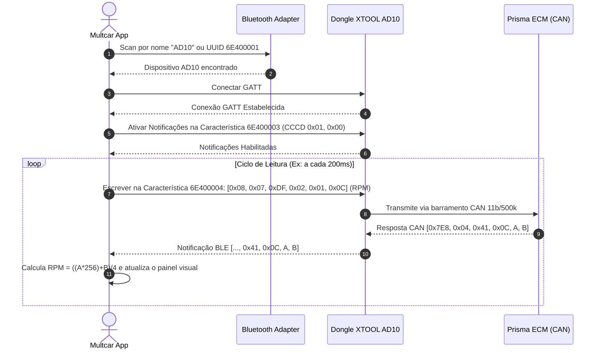

# 🛰️ Especificação do Protocolo Bluetooth Low Energy (BLE) — XTOOL Advancer AD10

> **Status:** Engenharia reversa aprofundada concluída com sucesso a partir de `classes.dex` e biblioteca nativa C++ `libobdcore.so`.  
> **Data:** 09/nov/2026  
> **Finalidade:** Base de desenvolvimento do aplicativo proprietário **Multcar** para celular e central multimídia K2401 (Chevrolet Prisma LTZ 2015).

---

## 1. Arquitetura de Comunicação BLE GATT

O XTOOL AD10 opera baseado no perfil **Nordic UART Service (NUS)** sobre Bluetooth 4.2 Low Energy (BLE).

| Parâmetro | UUID / Valor | Descrição |
| :--- | :--- | :--- |
| **Service UUID** | `6E400001-B5A3-F393-E0A9-E50E24DCCA9E` | Serviço principal de comunicação |
| **Write Characteristic (TX)** | `6E400004-B5A3-F393-E0A9-E50E24DCCA9E` | Onde o App envia comandos para o dongle |
| **Notify Characteristic (RX)** | `6E400003-B5A3-F393-E0A9-E50E24DCCA9E` | Onde o dongle transmite as respostas para o App |
| **CCCD Descriptor** | `00002902-0000-1000-8000-00805f9b34fb` | Descritor para habilitar notificações (`0x01, 0x00`) |
| **Tamanho Máx. Pacote (MTU Chunk)** | `20 bytes` | Envio fragmentado em blocos de até 20 bytes |

---

## 2. Handshake Inicial & Configuração do Multiplexador de Hardware

O AD10 conta com relés multiplexadores de pinos na porta OBD2 e microcontrolador dedicado. Conforme descoberto na classe C++ `CAD10Prot` em `libobdcore.so`, o dongle requer uma sequência de despertar e chaveamento de barramento antes de iniciar a transmissão de PIDs:

1. **Wake-up MCU:** `[0x81, 0x00, 0x81]`
2. **Ativação CAN Pinos 6+14 a 500 kbps (String oficial XTOOL):**
   ```text
   CAN,std,0,pin:6+14,07df/07e0/07f0,period:0/2/200/80/1000\r\n
   ```
   * Conecta os transceptores internos nos pinos físicos 6 (CAN High) e 14 (CAN Low) da porta OBD2 do Prisma.
   * Filtros de aceitação configurados para o Broadcast Universal `0x07DF` e ECU do motor `0x07E0`.
3. **Leitura Direta da Tensão da Bateria (Hardware AD10):** `[0x83, 0x00, 0x83]`

---

## 3. Estrutura dos Frames CAN (Padrão ISO 15765-4 com Padding 8 bytes)

A ECU Delphi do Chevrolet Prisma 1.4 SPE/4 Flex descarta frames curtos com tamanho inferior a 8 bytes. O frame transmitido deve conter DLC=8 e preenchimento com `0x55`:

```
+------------+------------+------------+------------+------------+------------+------------+------------+------------+------------+------------+
| Byte 0     | Byte 1     | Byte 2     | Byte 3     | Byte 4     | Byte 5     | Byte 6     | Byte 7     | Byte 8     | Byte 9     | Byte 10    |
| DLC        | CAN ID High| CAN ID Low | ISO-TP Len | Mode       | PID        | Pad 1      | Pad 2      | Pad 3      | Pad 4      | Pad 5      |
| 0x08       | 0x07       | 0xDF       | 0x02       | 0x01       | PID        | 0x55       | 0x55       | 0x55       | 0x55       | 0x55       |
+------------+------------+------------+------------+------------+------------+------------+------------+------------+------------+------------+
```

* **Byte 0:** `0x08` (DLC fixo de 8 bytes de dados CAN)
* **Byte 1 e 2:** `0x07`, `0xDF` (Identificador CAN Broadcast universal `0x07DF`)
* **Byte 3:** Tamanho da carga útil ISO-TP (`0x02` para Mode 01 + PID)
* **Byte 4:** Modo OBD (`0x01` para dados em tempo real)
* **Byte 5:** Código do PID solicitado
* **Bytes 6 a 10:** Bytes de preenchimento `0x55` (padrão SAE J1979 / GM)

#### Exemplos de Frames Completos (11 bytes):
* **RPM do Motor (PID 0x0C):** `[0x08, 0x07, 0xDF, 0x02, 0x01, 0x0C, 0x55, 0x55, 0x55, 0x55, 0x55]`
* **Temperatura da Água / Arrefecimento (PID 0x05):** `[0x08, 0x07, 0xDF, 0x02, 0x01, 0x05, 0x55, 0x55, 0x55, 0x55, 0x55]`
* **Velocidade do Veículo (PID 0x0D):** `[0x08, 0x07, 0xDF, 0x02, 0x01, 0x0D, 0x55, 0x55, 0x55, 0x55, 0x55]`
* **Posição da Borboleta TBI (PID 0x11):** `[0x08, 0x07, 0xDF, 0x02, 0x01, 0x11, 0x55, 0x55, 0x55, 0x55, 0x55]`
* **Pressão MAP (PID 0x0B):** `[0x08, 0x07, 0xDF, 0x02, 0x01, 0x0B, 0x55, 0x55, 0x55, 0x55, 0x55]`
* **Tensão do Módulo / Bateria (PID 0x42):** `[0x08, 0x07, 0xDF, 0x02, 0x01, 0x42, 0x55, 0x55, 0x55, 0x55, 0x55]`
* **Ler Códigos de Falha DTCs (Mode 03):** `[0x08, 0x07, 0xDF, 0x01, 0x03, 0x55, 0x55, 0x55, 0x55, 0x55, 0x55]`
* **Limpar DTCs (Mode 04):** `[0x08, 0x07, 0xDF, 0x01, 0x04, 0x55, 0x55, 0x55, 0x55, 0x55, 0x55]`

---

## 4. Estrutura de Resposta (AD10 → App)

As respostas chegam através da notificação da característica `6E400003`.

* O módulo de injeção (ECM) do Prisma responde sob o identificador `0x7E8`.
* O modo de resposta vem acrescido de `0x40` (Modo 01 responde como `0x41`).
* **Estrutura típica recebida:**
  `[ ... 0x07, 0xE8, Tamanho, 0x41, PID, ByteA, ByteB ... ]`

### Fórmulas de Decodificação:
1. **RPM:**
   $$\text{RPM} = \frac{(A \times 256) + B}{4}$$
2. **Temperatura do Líquido de Arrefecimento:**
   $$\text{Temp (°C)} = A - 40$$
3. **Velocidade:**
   $$\text{Velocidade (km/h)} = A$$
4. **Tensão da Bateria / Módulo:**
   $$\text{Tensão (V)} = \frac{(A \times 256) + B}{1000}$$

---

## 5. Fluxo Completo de Conexão e Inicialização



---

## 6. Arquitetura de Descoberta e Auto-Conexão BLE

### 6.1. Mecanismo de Escaneamento do App Oficial (`BluetoothHelper`)
A descompilação de `classes.dex` revelou como o XTOOL AD10 é localizado e pareado:
- **Ausência de Pareamento Clássico:** Por ser estritamente BLE 4.2 (GATT), o dongle não requer nem suporta pareamento nas Configurações de Bluetooth do Android com código PIN.
- **Varredura Aberta:** O método `startScan()` executa `BluetoothLeScanner.startScan()` com `ScanFilter` irrestrito.
- **Filtro em Tempo de Execução:** No callback `onScanResult`, o app inspeciona `ScanResult.getDevice().getName()`.
- **Auto-Conexão:** Se o nome coincidir com `"AD10"`, a busca é cancelada na hora (`stopScanBluetooth()`) e o método `notifyAd10Found()` conecta automaticamente ao endereço MAC encontrado.
- **Reconexão Rápida:** O endereço MAC é salvo em cache (`key_last_mac`). Em inicializações seguintes, o app conecta direto no endereço sem necessidade de nova varredura de rádio.

---

## 7. Status da Implementação no Aplicativo Multcar Pro

O protocolo foi integralmente implementado e validado:
- **APK Nativo:** Compilado com Capacitor e plugin `@capacitor-community/bluetooth-le`, reproduzindo a auto-conexão transparente do app oficial com TypedArray protegido.
- **PWA (Web Bluetooth):** Interface web moderna executando `navigator.bluetooth` sobre HTTPS com suporte a instalação na tela inicial do smartphone.
- **Handshake de Pinos 6+14 e Padding 8b:** Implementado para comunicação direta com a injeção eletrônica Delphi do Prisma 1.4.
- **PIDs Calibrados para o Prisma 1.4:** Velocidade, RPM, Temperatura da Água, Tensão da Bateria/Módulo, Pressão MAP, Carga do Motor, LTFT e Sonda Lambda.
- **Diagnóstico DTC:** Varredura (Modo 03) e limpeza de falhas da injeção eletrônica (Modo 04).

---
*Especificação técnica atualizada em 09/nov/2026 com engenharia reversa completa do protocolo XTOOL AD10 e correção do barramento CAN.*

